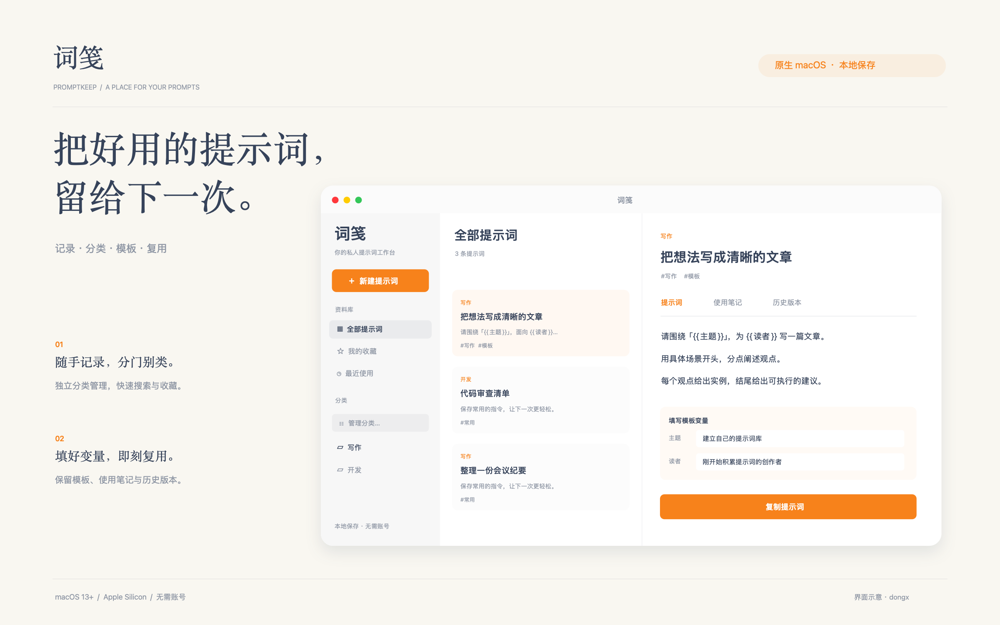

# 词笺


词笺是一个原生 macOS 提示词记录工具，用于在本机整理、查找和复用提示词。

好用的提示词总是散落在聊天记录和备忘录里，等到想用，又找不到了。

词笺把常用提示词集中存下来，分好类、加上标签，需要时搜一下、复制就能用。支持模板变量，替换主题、对象等内容，不用每次从头修改。数据保存在本机，无需注册账号。



## 功能

- **整理记录**：新建、编辑、删除、创建副本，支持独立分类管理、标签和收藏。
- **快速查找**：搜索标题、正文、标签及使用笔记，按更新时间、名称或使用次数排序。
- **模板复用**：识别 `{{变量名}}`，填写变量后复制完整提示词。
- **使用笔记**：记录适用场景、使用方法和改进想法。
- **版本回看**：修改正文或笔记时保留旧版本，支持恢复。
- **本地备份**：导出 JSON，合并导入时保留相同 ID 的本机记录。

不调用模型服务，也不依赖浏览器或后台服务。

## 使用场景

- **日常写作**：保存常用的改写、总结和表达模板，需要时填入主题与读者即可复用。
- **开发工作**：整理代码审查、问题排查和文档编写的指令，按项目或用途分类。
- **持续改进**：记录适用场景和使用心得，修改正文后可回看旧版本。

## 安装与快速开始

| 项目 | 要求 |
| --- | --- |
| 系统 | macOS 13 或更高版本 |
| 处理器 | Apple 芯片（arm64） |
| 日常使用 | 无需安装 Python 或其他运行时 |
| 源码构建 | Xcode 及 macOS SDK |

如已有应用压缩包，解压后将 `词笺.app` 拖入「应用程序」文件夹，再双击打开。也可以从源码构建：

```sh
./scripts/build.sh
```

构建完成后，将 `build/词笺.app` 拖入「应用程序」文件夹。

1. 点击「新建提示词」，填写标题和正文。
2. 选择分类，按需填写逗号分隔的标签和使用笔记，然后保存。
3. 在列表中选择记录；如包含模板变量，先填入变量，再点击「复制提示词」。

## 使用说明

### 分类管理

分类列表上方的「管理分类…」可统一新建、重命名和删除分类；顶部「文件 → 分类管理…」也保留入口。重命名会同步更新其中提示词的分类；删除分类会把提示词移入「未分类」，不会删除内容。「未分类」为系统分类，不能重命名或删除。新建和编辑提示词时可从已有分类中选择，空分类也会随备份导出。

### 整理与搜索

侧边栏可切换全部记录、收藏、已使用的记录和分类。详情页的星形按钮用于收藏；右键单击列表记录可以编辑、创建副本或删除。删除前会确认，目前不提供回收站，建议定期备份。

### 模板与笔记

在正文中写入 `{{主题}}` 等变量，详情页会显示对应输入框。填写变量只影响预览和复制内容，不修改原模板。未填写的变量保留占位符。

「使用笔记」为可选内容。正文或笔记变更后，旧内容会出现在「历史版本」中；恢复时，当前内容也会保留为版本。

### 备份与数据

点击侧边栏底部的「导出备份」保存 JSON；「导入备份」合并记录，相同 ID 保留本机内容。导入文件上限为 10 MB。

资料库的具体路径见[开发文档](docs/development.md#数据)。数据未额外加密，建议定期导出备份。当前适合单用户使用。

PromptFlow 数据可先导出 JSON，再按[迁移说明](docs/development.md#promptflow-迁移)转换后导入。

## 开发与验证

界面使用 SwiftUI 和 AppKit，无第三方依赖；图标由项目脚本生成。构建与检查命令：

```sh
./scripts/build.sh
codesign --verify --deep --strict build/词笺.app
python3 -m unittest discover -s tests -p 'test_migration.py' -v
```

编译和签名检查不替代功能验证。修改界面后，应检查保存、搜索、模板复制、历史恢复和备份导入，并在浅色、深色模式下验证鼠标及键盘操作。更多实现说明见[开发文档](docs/development.md)。

## 贡献

欢迎提交问题与改进建议。问题报告请提供 macOS 版本、复现步骤和预期结果；代码修改请说明行为变化及验证方式，避免在截图、日志或测试数据中包含私人提示词和凭据。

## 许可证

Copyright (c) 2026 dongx。

本项目基于 [GNU Affero General Public License v3.0](LICENSE) 发布。
